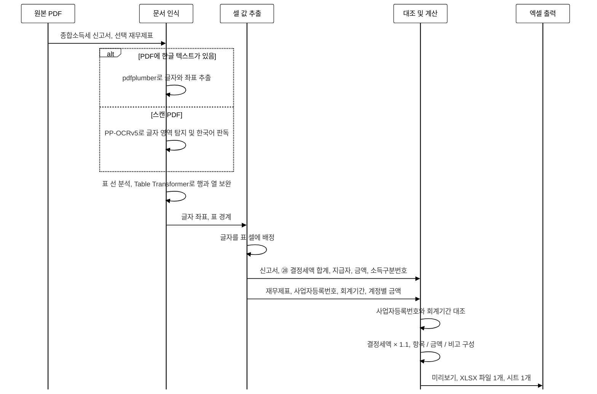

# Data Preprocessor

종합소득세 신고서와 선택 입력 재무제표를 로컬에서 분석해 엑셀 한 파일로 저장합니다.

## Windows

64비트 Python 3.12(Tcl/Tk 포함)를 설치한 다음 PowerShell에서 실행합니다.

```powershell
py -3.12 -m venv .venv
.\.venv\Scripts\python.exe -m pip install -r requirements.txt
.\.venv\Scripts\python.exe install_models.py
.\.venv\Scripts\python.exe desktop.py
```

## macOS

```bash
python3.12 -m venv .venv
.venv/bin/python -m pip install -r requirements.txt
.venv/bin/python install_models.py
.venv/bin/python desktop.py
```

첫 설치에서 공개 모델 가중치를 내려받습니다. 이후 신고서, 재무상태표, 손익계산서 PDF를 선택한 뒤 **추출 시작 → 엑셀 저장**을 누릅니다. 재무제표는 선택 사항입니다. 신고서와 추출 결과는 로컬에서 처리됩니다.

## Data Flow



## 딥러닝 모델은 어떤 일을 하나요?

| 모델 | 동작 원리 |
| --- | --- |
| Table Transformer, Detection | CNN으로 페이지 이미지의 특징을 추출하고, DETR의 객체 쿼리로 표 영역의 경계 상자를 예측합니다. |
| Table Transformer, Structure Recognition | 잘라낸 표 이미지에서 행과 열의 경계를 예측합니다. 앱이 경계를 교차해 셀을 구성합니다. |
| PP-OCRv5 Mobile, 글자 탐지 | 이미지에서 글자일 가능성이 높은 영역을 찾고, 확률 지도를 글자 경계 상자로 변환합니다. |
| PP-OCRv5 Mobile, 한국어 글자 인식 | 글자 영역에서 위치별 문자 확률을 예측하고, CTC로 반복과 빈 예측을 정리해 문자열을 반환합니다. |
