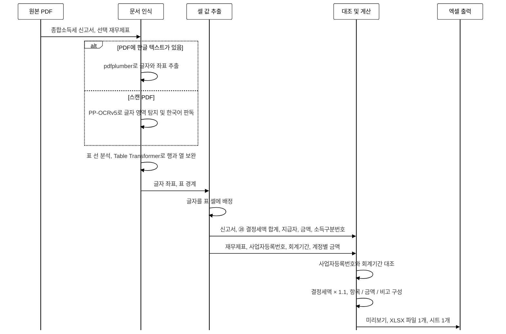

# Data Preprocessor

종합소득세 신고서와 재무제표를 로컬에서 분석해 엑셀 한 파일로 저장합니다.

## Windows

64비트 Python 3.12(Tcl/Tk 포함)를 설치한 다음 PowerShell에서 실행합니다.

```powershell
py -3.12 -m venv .venv
.\.venv\Scripts\python.exe -m pip install -r requirements.txt
.\.venv\Scripts\python.exe install_models.py
.\.venv\Scripts\python.exe desktop.py
```

## macOS

```bash
python3.12 -m venv .venv
.venv/bin/python -m pip install -r requirements.txt
.venv/bin/python install_models.py
.venv/bin/python desktop.py
```

첫 설치에서 공개 모델 가중치를 내려받습니다. 이후 신고서, 재무상태표, 손익계산서 PDF를 선택한 뒤 **추출 시작 → 엑셀 저장**을 누릅니다. 재무제표는 선택 사항입니다. 신고서와 추출 결과는 로컬에서 처리됩니다.

## Data Flow



## 딥러닝 모델 동작원리

| 모델 | 동작 원리 |
| --- | --- |
| **Table Transformer, 표 탐지** | **① 입력 :** PDF 한 쪽을 이미지로 바꿔 픽셀 격자로 읽습니다.<br><br>**② 합성곱 :** 가중치가 들어 있는 작은 격자인 필터를 이미지 위에서 일정한 간격으로 옮깁니다. 각 위치에서 겹치는 픽셀 값과 가중치를 곱한 뒤 더합니다. 예를 들어 가로 경계에 반응하도록 학습된 필터는 밝고 어두운 픽셀이 위아래로 갈리는 위치에서 큰 값을 냅니다. 이 위치별 점수를 모은 것이 **특징 지도**입니다.<br><br>**③ 특징 조합 :** CNN의 앞쪽 층에서 찾은 선과 경계는 뒤쪽 층에서 조합됩니다. 격자 모양이나 일정 간격으로 정렬된 글자처럼 표를 찾는 데 도움이 되는 특징이 만들어집니다.<br><br>**④ 출력 :** DETR은 특징 지도와 위치 정보를 바탕으로 페이지 전체에서 표가 있는 영역을 판단하고, 세액 계산표 같은 영역의 사각형 좌표를 반환합니다. |
| **Table Transformer, 구조 인식** | **① 입력 :** 앞 모델이 찾은 좌표로 페이지에서 표 부분을 잘라냅니다.<br><br>**② 행과 열 찾기 :** 두 번째 모델이 표 이미지를 보고, 가로로 이어지는 영역은 행, 세로로 이어지는 영역은 열로 예측합니다. 각 행과 열의 위치가 사각형 좌표로 나옵니다.<br><br>**③ 셀 만들기 :** 앱은 행과 열이 겹치는 영역을 셀로 구성하고, PDF에서 읽은 글자나 OCR로 찾은 글자의 좌표를 각 셀에 배정합니다. 원본에서 표 선을 읽을 수 있는 경우 앱은 그 경계도 사용합니다.<br><br>**④ 출력 :** 글자가 어느 행과 열에 속하는지 알 수 있습니다. 예를 들어 Python 규칙은 ‘결정세액 합계’ 행과 ‘종합소득세’ 열이 만나는 금액을 가져옵니다. |
| **PP-OCRv5 Mobile, 글자 탐지** | **① 입력 :** 스캔 PDF의 한 쪽을 이미지로 바꿉니다.<br><br>**② 위치별 점수 계산 :** 모델은 이미지에서 글자 획과 배열의 특징을 살펴보고, 각 위치가 글자 영역에 속할 가능성을 점수로 나타냅니다. 이 단계의 출력은 글자 위치를 나타내는 **확률 지도**입니다.<br><br>**③ 글자 영역 만들기 :** 점수가 높은 픽셀을 이어 붙여 한 줄이나 단어처럼 이어진 글자 영역을 찾고, 그 바깥을 둘러싸는 좌표를 구합니다.<br><br>**④ 출력 :** ‘12,087,040’이 보이는 위치를 잘라낼 수 있는 좌표가 나옵니다. 그 영역의 이미지는 다음 인식 모델로 전달됩니다. |
| **PP-OCRv5 Mobile, 한국어 글자 인식** | **① 입력 :** 앞 단계가 찾은 글자 영역을 잘라 모델에 넣습니다. 예를 들어 금액이 인쇄된 한 줄이 입력이 됩니다.<br><br>**② 문자 후보 예측 :** 모델은 글자의 획과 주변 모양을 바탕으로 가로 방향의 위치마다 한글, 숫자, 기호 후보의 확률을 계산합니다. 같은 글자가 이미지의 여러 위치에 걸쳐 있으면 같은 예측이 연속해서 나올 수 있습니다.<br><br>**③ 문자열 만들기 :** CTC 디코딩은 같은 문자의 연속 예측을 하나로 합치고, 문자가 없다는 뜻의 빈 토큰을 제거합니다. 빈 토큰은 실제 띄어쓰기와 구분됩니다.<br><br>**④ 출력 :** ‘12,087,040’ 같은 문자열이 나옵니다. 앱은 이 문자열을 글자 탐지 단계에서 얻은 좌표와 묶어 표의 해당 셀에 배정합니다. |


## 향후 확장 가능성

1. **소득 유형별 추출 범위 확대** — 이자, 배당, 사업, 근로, 연금, 기타소득 명세서의 다양한 서식과 추가 항목을 지원합니다.
2. **대량 PDF 처리 테스트** — 여러 고객의 문서를 일괄 처리하는 상황에서 추출 정확도, 처리 시간, 오류율을 검증합니다.
3. **신고 사례 분류** — 사업소득명세서와 재무제표를 바탕으로 개인사업자 신고 사례와 그 외 개인 신고 사례를 구분합니다.
4. **추출 결과 검증** — 누락, 오인식, 재무제표 연결 불일치 등 확인이 필요한 항목을 표시하고 원본과 대조할 수 있도록 개선합니다.

## 데이터 저장 방식

| 구분 | 저장 방식 |
| --- | --- |
| **현재** | 고객 PDF를 로컬에서 처리합니다. 추출값은 앱 실행 중 메모리에 보관하며 DB에 기록하지 않습니다. 엑셀 저장을 선택하면 지정한 위치에 결과 파일이 남습니다. 저장 과정에서 임시 파일을 만들고 정상 완료 시 정리합니다. |
| **향후** | DB 없이 로컬 처리하는 방식을 유지합니다. 엑셀도 메모리에서 생성해 중간 파일을 줄이고, 사용자가 저장을 선택한 경우에만 최종 엑셀을 기록하는 방향으로 개선합니다. |
