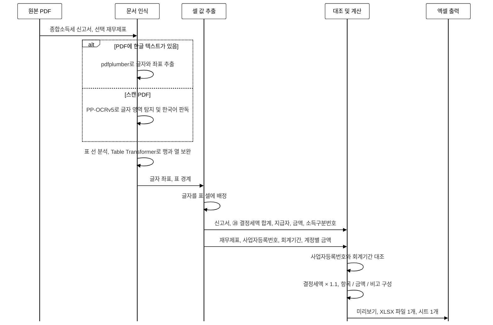

# Data Preprocessor

종합소득세 신고서와 재무제표를 로컬에서 분석해 엑셀 한 파일로 저장합니다.

## Windows

64비트 Python 3.12(Tcl/Tk 포함)를 설치한 다음 PowerShell에서 실행합니다.

```powershell
py -3.12 -m venv .venv
.\.venv\Scripts\python.exe -m pip install -r requirements.txt
.\.venv\Scripts\python.exe install_models.py
.\.venv\Scripts\python.exe desktop.py
```

## macOS

```bash
python3.12 -m venv .venv
.venv/bin/python -m pip install -r requirements.txt
.venv/bin/python install_models.py
.venv/bin/python desktop.py
```

첫 설치에서 공개 모델 가중치를 내려받습니다. 이후 신고서, 재무상태표, 손익계산서 PDF를 선택한 뒤 **추출 시작 → 엑셀 저장**을 누릅니다. 재무제표는 선택 사항입니다. 신고서와 추출 결과는 로컬에서 처리됩니다.

## Data Flow



## 딥러닝 모델 동작원리

| 모델 | 동작 원리 |
| --- | --- |
| **Table Transformer, 표 탐지** | **① 입력.** PDF 한 쪽을 이미지로 바꾸면 CNN은 이를 픽셀 값의 격자로 받습니다.<br>**② 합성곱.** 필터는 여러 가중치가 들어 있는 작은 격자입니다. 필터를 이미지 위에서 한 칸씩 옮기면서, 겹치는 픽셀 값과 가중치를 각각 곱한 뒤 더합니다. 가령 밝고 어두운 픽셀이 위아래로 뚜렷하게 갈리는 곳에서 가로 경계에 반응하는 필터의 점수가 커집니다. 같은 필터를 여러 위치에 적용한 점수들이 **특징 지도**가 됩니다.<br>**③ 특징 조합.** 앞쪽 층의 간단한 특징이 뒤쪽 층에서 조합되면서 가로선과 세로선의 교차, 일정한 간격으로 반복되는 글자 배치 같은 더 넓은 형태가 표현됩니다. 이런 필터의 가중치는 학습 과정에서 정해집니다.<br>**④ 표 위치 예측.** DETR이 CNN의 특징 지도와 위치 정보를 받아 페이지 전체를 비교한 뒤, 세액 계산표 같은 영역의 경계 상자를 예측합니다. 다음 단계는 이 좌표로 표 부분을 잘라 행과 열을 찾습니다. |
| **Table Transformer, 구조 인식** | 탐지한 영역을 잘라 두 번째 모델에 넣습니다. 모델은 표 안에서 가로로 이어지는 행과 세로로 이어지는 열의 범위를 각각 예측합니다. 앱은 행과 열이 겹치는 영역으로 셀을 만들고, 글자 좌표를 셀에 배정합니다. 이렇게 하면 ‘결정세액 합계’ 행과 ‘종합소득세’ 열이 만나는 금액 칸을 찾을 수 있습니다. |
| **PP-OCRv5 Mobile, 글자 탐지** | 스캔 이미지에서 글자가 있을 가능성을 픽셀 단위로 예측합니다. 가능성이 높은 픽셀을 묶어 글자가 모여 있는 영역의 좌표를 반환합니다. 이 좌표로 ‘12,087,040’처럼 숫자가 인쇄된 부분만 잘라 다음 인식 모델에 보냅니다. |
| **PP-OCRv5 Mobile, 한국어 글자 인식** | 잘라낸 글자 이미지를 받아 가로 방향의 위치마다 가능한 한글, 숫자, 기호에 확률을 매깁니다. CTC 디코딩으로 같은 글자의 연속 예측과 공백 토큰을 정리해 ‘12,087,040’ 같은 문자열을 만듭니다. 앱은 이 문자열과 앞 단계의 좌표를 함께 사용해 올바른 표 셀에 넣습니다. |
